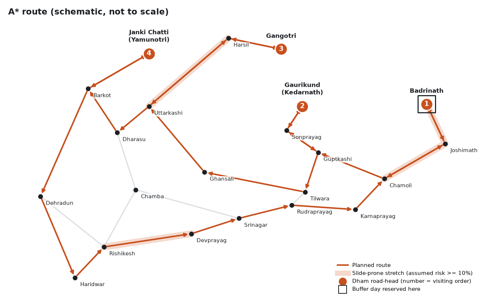
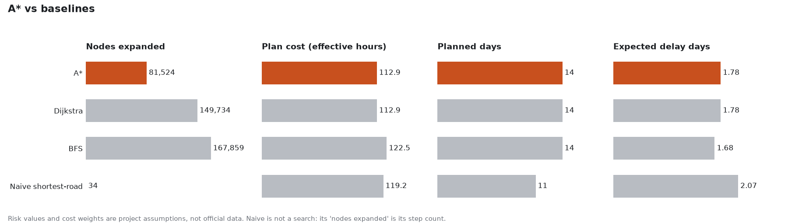
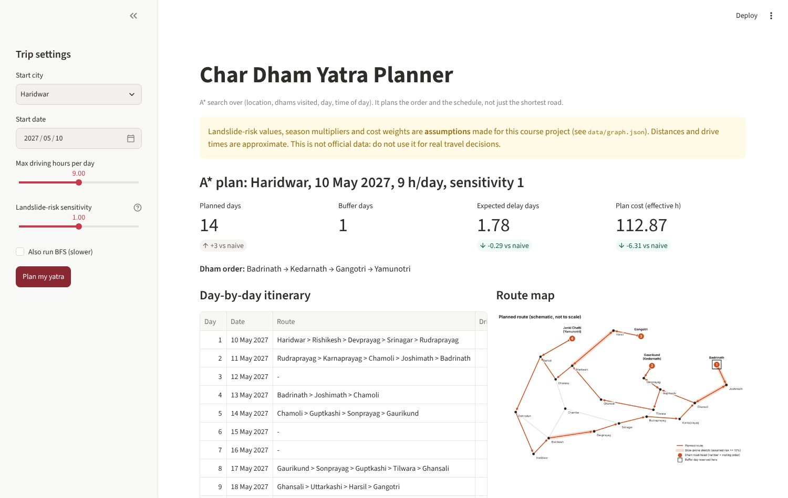

# Char Dham Yatra Planner using A*

An AI course project. It plans the **order and day-by-day schedule** for visiting Yamunotri, Gangotri,
Kedarnath and Badrinath, instead of only finding the shortest road.

> **Read this first.** Distances and drive times are approximate. Every landslide-risk value, season
> multiplier, darshan-day count and cost weight is an **assumption made for this project** and lives in
> `data/graph.json`. Nothing here is official data. Do not use it for real travel decisions.

## Problem

Most pilgrims plan with a maps app. It gives the fastest road but ignores landslide-prone stretches,
the night-driving ban on hill roads (commonly 8 PM to 5 AM), mountain driving fatigue, and routine road
closures. Tight plans break at the first closed road.

## Approach

| Part | Choice |
|---|---|
| State | `(location, dhams visited, day, time of day)` |
| Actions | drive to a neighbouring town; drive and reserve a buffer day; halt for the night |
| Cost g(n) | driving hours + expected landslide delay + near-night-ban penalty + fatigue penalty + overnight cost + buffer-day cost |
| Hard rules | no arrival after the ban starts (20:00); no more than `--max-hours-per-day` of driving |
| Heuristic h(n) | fastest link from here to any unvisited dham + minimum spanning tree over the unvisited dhams (and home) on base driving hours |
| Goal | all four dhams visited and back at the start town |

**Why h is admissible.** We must first reach some unvisited dham (at least the fastest link), and the rest
of the trip is a path through the remaining dhams and home. A path through a set of towns is a spanning
tree of them, so it is at least as long as the minimum spanning tree. Every real cost is base driving time
plus non-negative penalties, so h never overestimates.

**Why h is consistent.** Driving to a town v changes the fastest link by at most the fastest-road time to v
(triangle inequality), which is at most the step cost. Visiting dham t removes it from the tree, and
`MST(S) <= MST(S - t) + cheapest link from t`, which is the new h. Halts do not change h and cost >= 0.
The plain "MST including the current town" is admissible but can be inconsistent at junction towns, so the
current town is attached by its single fastest link instead. `tests/test_planner.py` checks both properties.

**Why not AO\*.** AO\* is for AND-OR graphs, where a problem splits into sub-problems that must all be
solved. A tour is one sequence of actions, a single path in an ordinary state graph, so A\* is the right tool.

**Baselines.** Dijkstra (A\* with h = 0), BFS (fewest actions, cost-blind), and a naive plan
(nearest dham next, fastest road, drive as far as the day allows, no buffer days).

## Results from the actual run

`python main.py --start Haridwar --max-hours-per-day 9 --start-date 2027-05-10`

| Algorithm | Nodes expanded | Plan cost | Days | Buffer days | Expected delay days |
|---|---|---|---|---|---|
| A\* | 81,524 | 112.87 | 14 | 1 | 1.78 |
| Dijkstra | 149,734 | 112.87 | 14 | 1 | 1.78 |
| BFS | 167,859 | 122.47 | 14 | 3 | 1.68 |
| Naive shortest-road | 34 steps (not a search) | 119.18 | 11 | 0 | 2.07 |

A\* finds the same optimal cost as Dijkstra with about 46% fewer expansions, and costs 5.3% less than the
naive plan. It takes 3 more planned days than the naive plan: with these cost weights, shorter driving days
and one buffer day at Badrinath are worth more than finishing early. Full output: `outputs/cli_output.txt`.
Runtimes are a few seconds and vary by machine.





## Install and run

**Windows (PowerShell)**
```powershell
python -m venv venv
venv\Scripts\activate
pip install -r requirements.txt
python main.py --start Haridwar --max-hours-per-day 9 --start-date 2027-05-10
streamlit run app.py
pytest -q
```

**Mac / Linux**
```bash
python3 -m venv venv
source venv/bin/activate
pip install -r requirements.txt
python main.py --start Haridwar --max-hours-per-day 9 --start-date 2027-05-10
streamlit run app.py
pytest -q
```

Expected output: the CLI prints the A\* itinerary, a comparison table and the naive itinerary, then saves
`route_map.png`, `route_map_naive.png`, `comparison.png` and `results.json` in `outputs/`.
Streamlit opens the app at http://localhost:8501. `pytest` reports `14 passed`.

Other CLI options: `--risk-sensitivity 1.5`, `--one-way`, `--no-plots`, `--graph path/to/graph.json`.

## Project structure

```
char-dham-planner/
  a_star.py        generic A* (priority queue, node counter, runtime)
  graph.py         loads data/graph.json, all-pairs fastest roads
  planner.py       state, actions, cost model, MST heuristic, itinerary
  baselines.py     Dijkstra, BFS, naive plan, compare()
  plots.py         route map and comparison chart (matplotlib)
  main.py          command-line interface
  app.py           Streamlit web app
  data/graph.json  towns, roads, risk assumptions, cost weights (editable)
  tests/           pytest unit tests
  outputs/         charts, screenshot and results from the real run
  Char_Dham_Yatra_Planner.pptx   6-slide presentation
  GITHUB_AND_DEPLOY_GUIDE.md     push to GitHub, deploy on Streamlit Cloud
  VIVA_CHEATSHEET.md             8 likely viva questions with answers
```

## Limitations and assumptions

- Risk probabilities, season multipliers and all cost weights are assumptions, not measured data.
- Distances and drive times are approximate and rounded to 0.5 h; the map is schematic.
- A blockage is modelled as an expected cost (probability x hours lost), not simulated day by day.
- One buffer day is reserved per risky stretch; real travellers would share slack across a region.
- Darshan time is fixed per dham (extra trek days for Yamunotri and Kedarnath are assumptions).
- Both visiting directions cost almost the same on a round trip, so A\* may pick the reverse of the
  traditional west-to-east order; tradition, registration slots and hotel availability are not modelled.
- At monsoon dates or high sensitivity the plan gains many buffer days and can hit the 40-day cap.

## Papers this project draws on

1. X. Ji et al., "Multi-Source Data-Driven Terrestrial Multi-Algorithm Fusion Path Planning Technology",
   *Sensors* 25(12), 3595, 2025. https://doi.org/10.3390/s25123595
2. A. Hyso et al., "Comparative Metaheuristic Approaches to Tourist Itinerary Optimization in
   Low-Infrastructure Urban Contexts: A Case Study of Tirana", *Informatica* 49, 217-232, 2025.
   https://doi.org/10.31449/inf.v49i36.12204
3. "Shortest path planning and dynamic rescue forces dispatching for urban flood disasters",
   *Scientific Reports*, 2025. https://doi.org/10.1038/s41598-025-06374-2

## Licence

MIT. See `LICENSE`.
